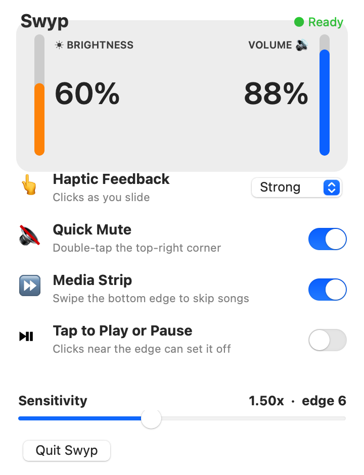

# Swyp

Turn your Mac's **trackpad edges into volume and brightness sliders**, with
music play/pause and haptic feedback.



> **Note:** This is an independent, open-source reimplementation built for
> learning, inspired by the commercial app **EdgeBar** by Shashank Bhardwaj
> ([edgebar.xyz](https://edgebar.xyz)). It is **not** affiliated with, endorsed
> by, or the official EdgeBar. If you want the polished product, buy the
> original. Consider renaming this fork before redistributing.

## What it does

| Gesture | Action |
|---|---|
| Slide a finger up/down the **right edge** of the trackpad | Volume |
| Slide a finger up/down the **left edge** | Brightness (built-in display) |
| Swipe sideways along the **bottom edge** | Skip track (Media Strip) |
| **Double-tap the top-right corner** | Quick Mute |
| **Tap** the bottom edge | Play / Pause |
| **Tap** a side edge (no drag) | Play / Pause — optional (Music, Spotify, Safari, …) |

- A **menu-bar control panel** (click the `▐` icon) with **live Brightness &
  Volume meters** and toggles for Haptic strength, Quick Mute, Media Strip,
  Tap-to-Play/Pause, and a Sensitivity slider.
- An on-screen **HUD slider** appears while you adjust.
- The trackpad gives a **haptic tick** at each step.
- Runs as a **menu-bar agent** (`▐` icon), no Dock icon.

## How it works

- **MultitouchSupport** (private framework) — raw normalized finger positions
- **CoreAudio** — output volume
- **DisplayServices** (private framework) — built-in display brightness
- **MediaRemote** (private framework) — system-wide play/pause
- **AppKit** `NSHapticFeedbackManager` — haptics

Private frameworks are loaded via `dlopen`/`dlsym` at runtime, so no private
SDK headers are required.

## Build

```sh
bash build.sh          # compiles src/main.swift into Swyp.app
```

Requires the Swift toolchain (`swiftc`) and macOS 13+.

## Test

```sh
./Swyp.app/Contents/MacOS/Swyp --selftest
```

The self-test round-trips volume and brightness (saving and restoring your
current values), confirms the trackpad device starts, loads MediaRemote, and
renders the HUD + fires a haptic.

## Run

```sh
open Swyp.app
```

Quit from the `▐` menu-bar icon → **Quit Swyp**.

## Caveats

- Brightness control works on the **built-in** display only, not external monitors.
- Uses private frameworks, so a future macOS version could change the ABI.
- Ad-hoc signed; Gatekeeper may warn on first launch (right-click → Open).

## License

MIT — see `LICENSE`. The name "EdgeBar" belongs to the original author; this
clone uses it only to describe what it reimplements.
